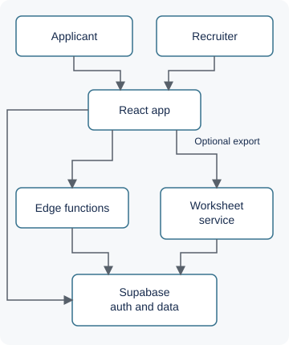

# Njord ResumeForm

**Maritime applicant intake and recruiter operations, presented under the Njord Holmes product brand.**

Collect structured seafarer applications, review qualifications, and coordinate recruitment from prospect intake through hiring. Applicants get a guided form; recruiters get a shared workspace for requirements, applications, scheduling, and reporting.

[Architecture](docs/architecture.md) · [Validation and evidence](docs/validation.md) · [View runnable code](examples/intake-demo.mjs) · [Workflow walkthrough](docs/walkthrough.md)

This is a public engineering showcase of a private application. The example is newly written, illustrative code using synthetic fixtures; it runs locally without credentials.

## Engineering highlights

- **One validation contract across intake:** draft progress and section completion reuse required-field checks. An empty repeatable row must not make a section look complete.
- **Workflow rules beyond the interface:** database migrations define allowed transitions, role checks, and version checks for prospect–requirement updates, so stale edits can be rejected at the backend boundary.
- **Separate operational views from reporting:** requirements, candidate funnels, and KPI pages share loading and derivation utilities. Core data failures show a retry state rather than misleading zero totals.
- **Keep document generation behind a service boundary:** a Python worksheet service authenticates exports, fetches an active workbook template, and populates it using the existing writer. Template fidelity remains a separate validation concern.
- **Progressive search assistance:** ordinary filters work independently of AI search. Semantic results appear before an additional reasoning pass; recruiters retain review and status controls.

These are implementation responsibilities visible in the reviewed repository, not a claim of sole authorship or measured commercial impact. [Inspect the decisions and source map](docs/architecture.md).

## Verified scope and evidence

| Area | Evidence |
|---|---|
| Guided intake | 19 sections; 13 marked mandatory in the current form constants |
| Recruiter access model | 3 named roles: Master Recruiter, Recruiter, Coordinator |
| Current validation check | 16/16 existing validation-contract tests passed in an isolated run |
| Current static checks | ESLint and Vite build passed; build emitted a large-chunk warning |
| Historical smoke baseline | 77 passed, 2 skipped, recorded for the June 8, 2026 snapshot |

Current checks were run on September 29, 2026. The historical smoke result is not a result for today's login flow: some tests still expect the removed Google-login interface. Counts describe code scope and test cases, not users or unique applicant samples. [Methods, provenance, and limitations](docs/validation.md) · [Aggregate JSON](evidence/metrics.json).

## How it fits together

The frontend has Vercel configuration; Supabase supplies authentication, database access, storage, and edge functions. Worksheet generation has a separate containerized service. This describes the implementation boundaries, not a fresh audit of every live deployment. [See intake, search, and export flows](docs/architecture.md).

## A decision you can run

A form can contain an education row whose fields are all blank. Counting that row as progress creates a false sense of completion. The project uses validation, rather than object presence, to determine completion.

The public example demonstrates this pattern with two synthetic sections:

| Scenario | Completed sections | Submission gate |
|---|---|---|
| Blank education row | 0 of 2 | Blocked |
| Education complete, declaration missing | 1 of 2 | Blocked |
| Education and declaration complete | 2 of 2 | Ready |

**[View code](examples/intake-demo.mjs)** · [Synthetic scenarios](examples/synthetic-scenarios.json) · [Run commands and expected output](examples/README.md)

The example is intentionally narrower than the application's full validation rules. “Ready” means the example's two checks passed, not that an applicant is qualified for employment.

## Applicant and operator workflows

- **Applicants:** arrive through emailed magic links, save form drafts, review required fields, and submit an application.
- **Recruiters:** sign in with an email username and password, manage prospects and requirements, review applications and compliance prompts, schedule events, and record pipeline outcomes.
- **Master Recruiters:** manage team access and configuration; authorized staff can generate reports and customer worksheets.

The current magic-link code is present; end-to-end delivery and rollout validation remain open in the source task list. [Follow a synthetic walkthrough](docs/walkthrough.md).

## Technology

- **Web:** React, JavaScript, Vite, React Router, Tailwind CSS.
- **Backend:** Supabase Auth, PostgreSQL, SQL RPCs, Deno/TypeScript edge functions, storage.
- **Documents:** Python, Flask, Gunicorn, openpyxl, Pillow; jsPDF and AutoTable for reports.
- **Integrations:** Gemini embedding/reasoning proxies, transactional email, Microsoft Teams and Google Meet integration code.
- **Verification and delivery:** Playwright, ESLint, Vite build, Vercel configuration, Docker worksheet service.

## Access and project status

Recruiters can read this repository, inspect diagrams and aggregate evidence, and run the synthetic example. The full application, applicant records, customer templates, operational logs, credentials, and original Git history remain private. No open-source license is granted by this showcase.

Implemented code includes intake, recruiter workflows, compliance prompts, reports, and worksheet export. Remaining work includes current authentication smoke coverage, backend rollout reconciliation, worksheet fidelity checks, and validation of newer reporting and role flows. Historical Google OAuth and the local spreadsheet-conversion prototype are not the current product path. There is no public product demo or reviewed product screenshot in this showcase.
