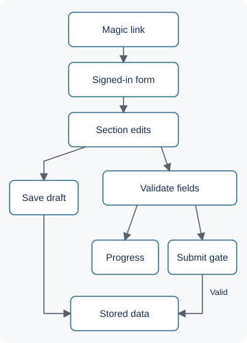
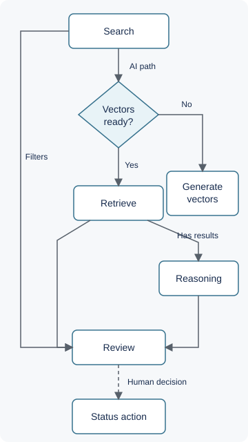
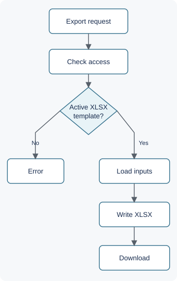

# Architecture and engineering decisions

[← Project overview](../README.md) · [Validation](validation.md) · [Walkthrough](walkthrough.md) · [View example code](../examples/intake-demo.mjs)

This page describes the reviewed implementation. A component's presence in source does not establish that its latest version is deployed or fully tested.

## Responsibilities and boundaries

| Component | Responsibility |
|---|---|
| React application | Applicant forms, recruiter workspace, permission-aware controls, client-side validation and reporting |
| Supabase Auth | Applicant magic-link sessions and recruiter email/password sessions |
| PostgreSQL and RPCs | Applications, prospects, requirements, role/permission data, workflow transitions and audit records |
| Edge functions | Privileged account operations, email and scheduling integrations, AI proxies, export audit requests |
| Python worksheet service | Verify caller and export permission, fetch template and application data, produce XLSX |

The browser makes authenticated data requests directly to Supabase as well as edge-function calls. Route guards improve the interface; database policies and backend authorization are separate enforcement points. The worksheet service uses privileged backend access after checking the caller, so its configuration and authorization boundary matter independently of frontend controls.

## Intake and progress

The form constants define 19 sections and a mandatory subset. `applicationProgress.js` calls the same section validator used for required-field checks. This avoids treating an allocated but empty repeatable record as completed work. The [public example](../examples/README.md) isolates that decision with newly written code.

Autosave exposes saving, saved, and error states and attempts an immediate save around relevant lifecycle events. These are best-effort browser operations, not a durable offline queue or a guarantee that every tab-close save succeeds.

A database trigger rejects a second non-terminal application for an applicant. The historical validation demonstrates sequential duplicate rejection and reopening after a terminal status. It does not prove race-free enforcement under concurrent inserts; the reviewed implementation uses an existence check in a trigger, and no concurrency stress result is claimed.

## Recruiter workflow and reporting

Prospects, requirements, and their junction records are distinct from application records. Requirement/junction RPCs use row locks and expected versions for relevant transitions; status triggers reject invalid transitions. This preserves workflow rules when a caller has stale state. Some bulk-operation version checks are optional, so this is not a blanket guarantee for every write path.

Requirements, candidate, and KPI pages share a loader and calculation utilities. Each mount still performs its own reads; this is not a database-wide transactional snapshot. Core load failures suppress the dashboard and expose retry. Display-only notes, remarks, and event failures can fall back to empty lists, which is a weaker completeness guarantee.

Report callers request audit logging before downloading CSV/PDF files. The backend verifies the caller and relevant export permissions; CSV values receive formula-trigger escaping. This is an implemented path, not an independent security certification or proof that every client can be prevented from retaining data it can already read.

Compliance prompts are computed from entered document, rank, course, and service-history data. They support human review; they do not authenticate certificates or establish universal maritime regulatory compliance. Persisted compliance snapshots and some destination-specific checks are deferred.

## Search: optional AI, human decisions

AI search checks embedding readiness and retrieves matching applications through a SQL RPC. Compound queries have split/merge logic, and active application statuses filter the loaded records. The UI first displays vector results, then calls the search service again with reasoning enabled and merges available analysis into those results. The reasoning stage evaluates a limited top subset, rather than every record.

The reasoning helper has an unavailable-analysis fallback, while other search failures surface errors. Model confidence is an output of the reasoning step, not calibrated accuracy. No quantitative search-quality evaluation was found in the reviewed evidence. Dashed arrows denote human decisions; there is no implemented automatic retraining or feedback-acceptance loop claimed here.

## Customer worksheet export

The active browser path calls the separate worksheet service directly. That service reuses the Python writer, works in a temporary directory, and returns a workbook with download headers. Authentication/permission failures and unsupported template inputs stop generation; storage or generation errors are returned to the caller. The service provides health and configuration-readiness endpoints, but configuration readiness is not a full dependency-health probe.

Earlier local conversion through a desktop spreadsheet app is historical. The current service expects a normalized XLSX template and does not perform that conversion. A template can look correct while retaining old values, so overwrite correctness, mapped values, photos, and formatting need separate verification. These checks remain incomplete for the full customer-template matrix.

## Deployment and observability

The repository contains Vercel SPA configuration, Supabase migrations/functions, and a Dockerized Flask/Gunicorn worksheet service. Hosted worksheet usage is recorded in project documentation; fresh deployment parity was not checked for this showcase. No production endpoint or admin link is included.

Implemented visibility includes UI error/retry states, function/service error responses, export audit records, and a status-history migration. That migration's live rollout is unresolved in the task list; true historical time-in-stage coverage is therefore not assumed. Expiry warnings have a manual invocation path, while daily scheduling remains pending. Console logs exist but are not a measured, centralized observability system.

One documented tradeoff is a no-op browser auth lock used to address startup stalls. Multi-tab refresh behavior remains an open limitation. No latency improvement is quantified because a reproducible timing benchmark was not available.

## Source map

These are relative paths in the private implementation, provided for provenance rather than public code links. The public runnable code is linked above.

| Decision or boundary | Inspected source |
|---|---|
| Active routes and applicant login | `src/App.jsx`, `src/pages/LoginPage.jsx` |
| Shared validation and progress | `src/utils/applicationProgress.js`, `src/utils/sectionValidation.js`, `src/constants/formSections.js` |
| Autosave | `src/hooks/useAutoSave.js` |
| Workflow versions and transitions | `supabase/migrations/2026060304_prospect_requirement_workflow.sql`, `2026060305_prospect_enrollment_rpcs.sql` |
| Reporting and core-load errors | `src/hooks/useKpiTrackerData.js`, `src/pages/RecruiterKpiPage.jsx`, `src/services/recruiterReportExportService.js` |
| Progressive search | `src/components/AISearch.jsx`, `src/services/embeddingService.js` |
| Worksheet boundary | `src/services/worksheetConfigService.js`, `services/worksheet-service/app.py` |
| Rollout caveats | `documentation.md`, `docs/tasks.md` |
